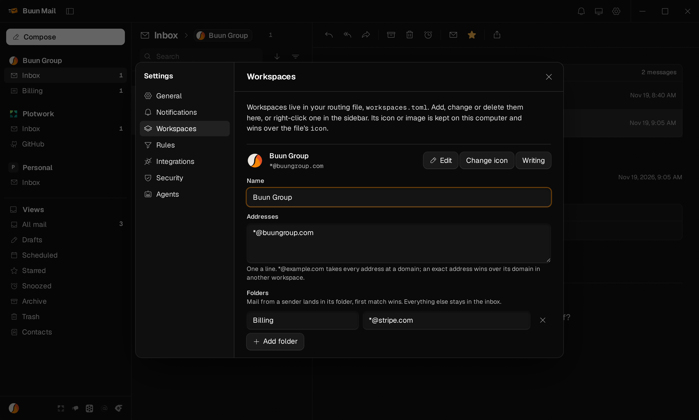

<div align="center">

<picture>
  <source media="(prefers-color-scheme: dark)" srcset=".github/assets/readme/hero-dark.svg">
  
</picture>

<p>
  <a href="https://github.com/buun-group/buun-mail/releases/latest"></a>
  <a href="LICENSE"></a>
  
  
  
  
</p>

<p>
  <a href="#install"><b>Install</b></a>
  &nbsp;&nbsp;&nbsp;
  <a href="#features"><b>Features</b></a>
  &nbsp;&nbsp;&nbsp;
  <a href="#how-it-works"><b>How it works</b></a>
  &nbsp;&nbsp;&nbsp;
  <a href="#build-from-source"><b>Build from source</b></a>
  &nbsp;&nbsp;&nbsp;
  <a href="#more-from-buun-group"><b>More from Buun Group</b></a>
</p>

</div>

Buun Mail is a local desktop mail client for people who run more than one address: a few businesses, a side project,
a personal inbox. Every message is filed into a **workspace** and a **folder** by the exact address it was delivered
to, so you read everything in one window instead of jumping between Gmail, Outlook and Proton. Your mail stays on your
computer, as plain `.eml` files with a SQLite index beside them.

<picture>
  <source media="(prefers-color-scheme: dark)" srcset=".github/assets/readme/app-dark.png">
  
</picture>

## Install

Download the file for your system from the [latest release](https://github.com/buun-group/buun-mail/releases/latest).
Settings, General can check that page once a day and say when a newer version is out.

| System | File | Notes |
|---|---|---|
| Debian, Ubuntu, Mint, Pop!_OS | `Buun.Mail_<version>_amd64.deb` | `sudo apt install ./Buun.Mail_*.deb` |
| Fedora, RHEL, openSUSE | `Buun.Mail-<version>-1.x86_64.rpm` | `sudo dnf install ./Buun.Mail-*.rpm` |
| Any other Linux | `Buun.Mail_<version>_amd64.AppImage` | `chmod +x`, then run it |
| Arch, Manjaro, EndeavourOS | `packaging/arch/PKGBUILD` | `makepkg -si` builds and installs from source, or use the AppImage |
| Windows | `Buun.Mail_<version>_x64-setup.exe` or `.msi` | Unsigned for now: SmartScreen asks, choose More info, then Run anyway |
| macOS, Apple silicon | `Buun.Mail_<version>_aarch64.dmg` | Unsigned for now: right-click the app, then Open |
| macOS, Intel | `Buun.Mail_<version>_x64.dmg` | As above |

A release built by hand carries a `SHA256SUMS` file. [packaging/README.md](packaging/README.md) has more on which file
to pick.

## Features

### Reading

| Feature | What it does |
|---|---|
| Conversations | Replies grouped into one thread |
| Search | Full text across every folder (SQLite FTS5) |
| HTML mail | In a sealed frame; remote images blocked until you allow them |
| Sender checks | SPF, DKIM and DMARC as the receiving server saw them |
| Attachments | Previews; documents open in your own app, programs never |
| Notes | A private note on any message |

### Organising

| Feature | What it does |
|---|---|
| Workspaces | Add, edit and delete in Settings or by right-clicking the sidebar |
| Rules | Tag, move, mark read or keep quiet on arrival, by sender, words or tags |
| Shelves | Archive, trash, stars, snooze, All mail |
| Many at once | Select several, right-click menus, quick actions |
| Contacts | Built from the mail you have |
| Export | `.eml`, JSON, CSV or text; import `.eml` and `.mbox` |

### Writing

| Feature | What it does |
|---|---|
| Compose | New, reply, reply all and forward with attachments |
| Sending | Through Resend or any SMTP server, from the address the mail went to |
| Safety net | Undo send, an outbox that retries, drafts |
| Later | Send later, and a reminder when nobody answers |
| Per workspace | A signature and a from address; templates |
| Unsubscribe | One click where the sender supports it, or block |

### Collecting

| Feature | What it does |
|---|---|
| Your domains | A Cloudflare Email Worker gateway pushes mail over a WebSocket, with a 30 second check behind it |
| IMAP | Gmail, iCloud, Fastmail and Zoho with app passwords, Proton Mail Bridge, any server; never marked read there |
| dissolve.email | Disposable inboxes as their own workspace after an OAuth sign-in |
| Alerts | Slack, Discord, ntfy, Telegram, SMS, email or a webhook when a rule matches |
| Digests | A daily summary of what arrived |
| Notifications | Header bell, toasts, desktop notifications, mute per workspace |

### Agents

| Feature | What it does |
|---|---|
| MCP server | `http://127.0.0.1:28700/mcp`, off until you turn it on |
| Access | A bearer token you can regenerate |
| 15 tools | List, search and read mail, tag, move, mark read, manage rules |
| Waiting | `wait_for_message` waits for a sign-up confirmation |
| Setup | One line for Claude Code, Cursor, VS Code or any MCP client |
| Audit | Every change logged under the agent's name |

### Security

| Feature | What it does |
|---|---|
| Local first | Your mail is stored on your computer, nowhere else |
| Sealed secrets | API keys and passwords encrypted at rest under a per-install key |
| Reveal code | Asked before a stored secret is shown again |
| Backup | The whole mailbox and settings in one passphrase-sealed file |
| Strict window | A tight content security policy; links open in your browser |
| Updates | Asks only GitHub's release list, once a day, and you can turn it off |


<picture>
  <source media="(prefers-color-scheme: dark)" srcset=".github/assets/readme/workspaces-dark.png">
  
</picture>

## How it works

<picture>
  <source media="(prefers-color-scheme: dark)" srcset=".github/assets/readme/routing-dark.svg">
  
</picture>

Point a domain's MX records at Cloudflare Email Routing and send its catch-all to a mail gateway, a small Cloudflare
Email Worker that holds each message until the app collects it. The envelope recipient survives that hop, so placing a
message is a table lookup on the address it was really sent to, never a guess from headers. IMAP mailboxes and
dissolve.email inboxes go through the same router.

<div align="center">
<picture>
  <source media="(prefers-color-scheme: dark)" srcset=".github/assets/readme/how-it-works-dark.svg">
  
</picture>
</div>

| Source | How mail arrives | Set up in |
|---|---|---|
| Your own domains | Cloudflare Email Routing, catch-all to a gateway Worker, pushed to the app the moment it lands | Settings, Integrations, Buun Mail Gateway |
| IMAP mailboxes | Collected on a timer or on Check now, left unread on the server | Settings, Integrations, IMAP |
| dissolve.email | Your disposable inboxes, synced after an OAuth sign-in | Settings, Integrations, dissolve.email |
| Files | `.eml` and `.mbox` imports | Settings, General |

The gateway's source is not published yet; until it is, IMAP and dissolve.email work without it. Several gateways can
feed one app, and the app can list, add and remove the domains each gateway receives for.

## Workspaces and the routing file

Workspaces live in a routing file, `workspaces.toml` in the app's config folder. You rarely need to open it: Settings,
Workspaces adds, changes and deletes them, and right-clicking a workspace in the sidebar does the same. The file is
edited in place, so your comments stay, and a change that would not load is refused with the reason.

```toml
[[workspace]]
id = "acme"            # stored with every message: never rename
name = "Acme"
icon = "briefcase"
match = ["*@acme.example", "accounts@personal.example"]
folders = [{ name = "Receipts", from = "*@stripe.com", icon = "receipt" }]
```

| Rule | What it means |
|---|---|
| An exact address beats its domain | `accounts@personal.example` lands in Acme even if another workspace owns `*@personal.example` |
| `+tags` are ignored | `me+shop@personal.example` matches `me@personal.example` |
| One home per address | Two workspaces claiming one pattern is an error, not a coin toss |
| Folders pick by sender | First match wins; everything else stays in the inbox |
| Nothing is lost | Mail nobody claims lands in **Unsorted**; a new address files the Unsorted mail it claims |
| Deleting is safe | A deleted workspace's mail moves to whichever workspace now claims it, or Unsorted |

A fresh install starts with one example workspace, Personal. [config/workspaces.example.toml](config/workspaces.example.toml)
lists every field and icon.

## Build from source

You need Node 22 or newer with pnpm, and Rust through rustup (the pinned 1.99 comes from `rust-toolchain.toml`; keep
`~/.cargo/bin` first on your `PATH` or an older compiler refuses the build). Linux also needs the WebKitGTK libraries
Tauri uses:

```bash
sudo apt install libwebkit2gtk-4.1-dev libgtk-3-dev librsvg2-dev   # Debian and Ubuntu
pnpm install
pnpm dev        # the desktop app, UI hot-reloading on http://localhost:28600
pnpm build      # this machine's installers, into target/release/bundle/
```

| Command | Does |
|---|---|
| `pnpm install` | Installs the UI and the Tauri CLI |
| `pnpm dev` | The desktop app, UI hot-reloading on http://localhost:28600 |
| `pnpm dev:ui` | The UI alone in a browser on a preview mailbox, no Rust build; the fastest way to tune the look |
| `pnpm check` | `cargo fmt --check`, oxlint, clippy (pedantic, warnings fail), `tsc`, vitest, `cargo test`; CI runs the same |
| `pnpm build` | This machine's installers, into `target/release/bundle/` |
| `pnpm release <version>` | Sets the version everywhere, commits and tags; pushing the tag builds every installer into a draft release |
| `pnpm dev:brand` | The brand preview on http://localhost:28610 |
| `pnpm brand:build` | Rebuilds the brand kit from the mark's geometry |

### Layout

| Path | What it is |
|---|---|
| [`crates/routing`](crates/routing/README.md) | Pure routing: which workspace and folder a message belongs to. No I/O |
| [`crates/message`](crates/message/README.md) | Pure parsing: raw mail to what the app shows. No I/O |
| [`crates/store`](crates/store/README.md) | The local store: SQLite index, raw `.eml` files, tags, rules, activity log |
| [`crates/rules`](crates/rules/README.md) | Pure rules: when mail matches, tag, move, mark read or keep quiet |
| [`apps/desktop`](apps/desktop/README.md) | The Tauri app: Rust shell in `src-tauri`, React UI in `ui` |
| [`packages/brand`](packages/brand/README.md) | The brand kit: mark, lockups, icons, social card, motion |
| [`packaging`](packaging/README.md) | Arch PKGBUILD, the Linux desktop entry, which installer to pick |
| [`config/workspaces.example.toml`](config/workspaces.example.toml) | The routing file a fresh install starts from, with comments |
| `.github/assets/readme` | The pictures on this page; `how-it-works.diagram` is the diagram's [Plotwork](https://plotwork.dev) source |

## Next

| Coming | Waiting on |
|---|---|
| Outlook.com sign-in | A Microsoft app registration |
| Passkey or system unlock for the reveal code | Platform work on each system |
| Signed macOS and Windows builds | Apple and Windows signing certificates |

## More from Buun Group

Buun Mail is made by [Buun Group](https://buungroup.com). The app's sidebar links to these too; none of them is needed
to use it.

<table>
<tr>
<td align="center" width="16%"><a href="https://buungroup.com"><picture><source media="(prefers-color-scheme: dark)" srcset="apps/desktop/ui/public/buun-group-dark.svg"></picture><br><b>Buun Group</b></a><br><sub>The studio</sub></td>
<td align="center" width="16%"><a href="https://plotwork.dev"><br><b>Plotwork</b></a><br><sub>Diagrams as code</sub></td>
<td align="center" width="16%"><a href="https://flung.dev"><picture><source media="(prefers-color-scheme: dark)" srcset="apps/desktop/ui/public/products/flung-dark.svg"></picture><br><b>Flung</b></a><br><sub>Social publishing API</sub></td>
<td align="center" width="16%"><a href="https://gunspec.io"><picture><source media="(prefers-color-scheme: dark)" srcset="apps/desktop/ui/public/products/gunspec-dark.png"></picture><br><b>GunSpec</b></a><br><sub>Firearm data API</sub></td>
<td align="center" width="16%"><a href="https://dissolve.email"><picture><source media="(prefers-color-scheme: dark)" srcset="apps/desktop/ui/public/products/dissolve-dark.svg"></picture><br><b>dissolve.email</b></a><br><sub>Disposable email</sub></td>
<td align="center" width="16%"><a href="https://cryptflare.com"><picture><source media="(prefers-color-scheme: dark)" srcset="apps/desktop/ui/public/products/cryptflare-dark.png"></picture><br><b>CryptFlare</b></a><br><sub>Secrets management</sub></td>
</tr>
</table>

| Product | What it does |
|---|---|
| [Plotwork](https://plotwork.dev) | Write a diagram in a few lines of text; Plotwork draws it, checks it in CI and tells you when it drifts. The diagram above is one |
| [Flung](https://flung.dev) | Schedule and publish posts to 27 social networks through one REST API, an SDK or an MCP server |
| [GunSpec](https://gunspec.io) | Specifications for more than 8,500 firearms, with calibers, ammunition and fitment, every figure sourced |
| [dissolve.email](https://dissolve.email) | A disposable address in one click, in the browser, the extension or the API; Buun Mail shows its inboxes as a workspace |
| [CryptFlare](https://cryptflare.com) | Encrypted, versioned secrets with fine-grained access for teams, built on Cloudflare |

<div align="center">
<br>
<a href="https://buungroup.com"><picture><source media="(prefers-color-scheme: dark)" srcset="packages/brand/src/svg/mark-on-dark.svg"></picture></a>
<br>
<sub>Made by <a href="https://buungroup.com">Buun Group</a>. The code follows the <a href="https://github.com/buun-group/standards">Buun Group coding standards</a>.</sub>
</div>

## Licence

Buun Mail is free software under the [GNU General Public License v3.0](LICENSE): use it, study it, change it and
share it. A changed version you distribute must be shared under the same licence, with its source.
