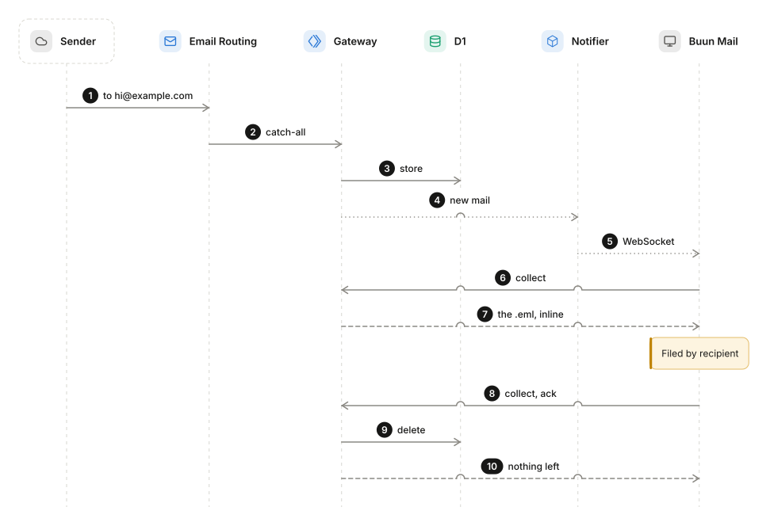
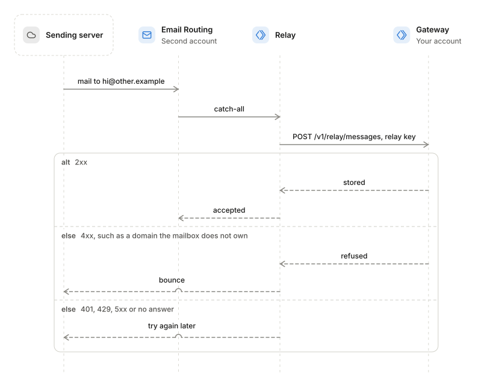
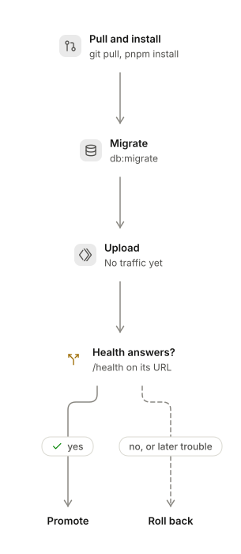

<div align="center">

<picture>
  <source media="(prefers-color-scheme: dark)" srcset="../packages/brand/src/svg/lockup-horizontal-on-dark.svg">
  
</picture>

# Self-hosting the mail gateway

Run your own Buun Mail gateway on your Cloudflare account, so mail to your domains reaches the app with its exact
recipient.

<p>
  
  
  
</p>

<p>
  <a href="#how-it-fits-together"><b>How it works</b></a>
  &nbsp;&nbsp;&nbsp;
  <a href="#what-it-costs"><b>Cost and limits</b></a>
  &nbsp;&nbsp;&nbsp;
  <a href="#1-before-you-start"><b>Set up</b></a>
  &nbsp;&nbsp;&nbsp;
  <a href="#keeping-it-running"><b>Updates</b></a>
  &nbsp;&nbsp;&nbsp;
  <a href="#troubleshooting"><b>Troubleshooting</b></a>
</p>

</div>

This guide is for anyone setting up Buun Mail for their own domains. It assumes a Cloudflare account and a terminal,
and nothing else.

## TL;DR

| Step | Command or place | Section |
|---|---|---|
| Get the code and sign in to Cloudflare | `pnpm install`, `wrangler login` | [1](#1-before-you-start) |
| Make the database | `wrangler d1 create buun-mail-gateway`, then paste its id | [2](#2-make-the-database) |
| Give the gateway its Cloudflare token | `wrangler secret put` twice | [3](#3-give-the-gateway-a-cloudflare-token) |
| Deploy | `pnpm --filter @buun-mail/gateway deploy` | [4](#4-deploy-the-gateway) |
| Make a mailbox and copy its token | `mailbox create --env production` | [5](#5-make-a-mailbox) |
| Connect the app and add your domains | Settings, Integrations, Buun Mail Gateway | [6](#6-connect-buun-mail-and-add-domains) |
| A domain in another Cloudflare account | Deploy the relay there | [7](#7-a-domain-in-another-cloudflare-account) |

## How it fits together

Each domain's MX records point at Cloudflare Email Routing. Its catch-all rule sends every message to the gateway, an
Email Worker in your account. The gateway keeps the message in D1 (Cloudflare's SQLite database) with the address it
was really sent to, and a Durable Object tells the app over a WebSocket. The app collects the message, files it by
that address, and tells the gateway to forget it.

<div align="center">
<picture>
  <source media="(prefers-color-scheme: dark)" srcset="assets/self-hosting/architecture-dark.svg">
  
</picture>
</div>

| | Part | Lives in | Code |
|---|---|---|---|
|  | **Gateway Worker**: receives, holds and hands over mail | Your Cloudflare account | [`apps/gateway`](../apps/gateway/README.md) |
|  | **Relay Worker**: only for a domain in a second account | That other account | [`apps/relay`](../apps/relay/README.md) |
| <picture><source media="(prefers-color-scheme: dark)" srcset="../packages/brand/src/svg/mark-on-dark.svg"></picture> | **Buun Mail**: files every message by its recipient | Your computer | `apps/desktop` |

### One message, start to finish

<picture>
  <source media="(prefers-color-scheme: dark)" srcset="assets/self-hosting/one-message-dark.svg">
  
</picture>

Nothing stays on Cloudflare once the app has it. Mail nobody collects is deleted after 30 days by a daily clean-up.

## What it costs

Everything runs on Cloudflare's **free plan**. The gateway uses these products:

| | Product | What the gateway uses it for | Free plan | Workers Paid ($5 a month) |
|---|---|---|---|---|
|  | [Email Routing](https://developers.cloudflare.com/email-routing/) | MX, and the catch-all that hands mail to the gateway | Free. Messages up to 25 MiB, 200 rules per domain | Same |
|  | [Workers](https://developers.cloudflare.com/workers/platform/pricing/) | The gateway, the relay, and every call from the app | 100,000 requests a day, 10 ms CPU per request | 10 million requests a month included, then $0.30 per million |
|  | [D1](https://developers.cloudflare.com/d1/platform/pricing/) | Mailboxes, domains, and mail waiting to be collected | 5 million rows read and 100,000 written a day; 500 MB per database | 25 billion reads and 50 million writes a month included; 10 GB per database |
|  | [Durable Objects](https://developers.cloudflare.com/durable-objects/platform/pricing/) (SQLite) | One notifier per mailbox, holding the app's WebSocket | 100,000 requests and 13,000 GB-s a day | 1 million requests and 400,000 GB-s a month included |
|  | [Cron Triggers](https://developers.cloudflare.com/workers/platform/limits/) | The daily clean-up of mail older than 30 days | 5 per account (the gateway uses 1) | 1,000 per account |
|  | [Secrets](https://developers.cloudflare.com/workers/configuration/secrets/) | The gateway's Cloudflare token, the relay's key | Free | Free |
|  | [R2](https://developers.cloudflare.com/r2/pricing/) (optional) | Raw messages, instead of D1 | 10 GB-month, 1 million writes and 10 million reads a month | $0.015 per GB-month after that |

Figures are from Cloudflare's pricing pages in November 2026. Check them before you rely on them.

### How far the free plan goes

These are rough sums from what the gateway does per message, not measurements:

| Limit | What uses it | In practice |
|---|---|---|
| 100,000 Worker requests a day | About 4 per message: the delivery, then the app's list, fetch and acknowledge | Around 20,000 messages a day |
| 100,000 D1 rows written a day | A few rows per message, plus one per 512 KiB of its raw size | Thousands of ordinary messages a day |
| 500 MB per D1 database | Mail that is waiting to be collected | Only fills if the app stays offline for a long time while large mail arrives. Turn on R2, or move to Workers Paid |
| 10 ms of CPU per request | Storing a message and answering the app | Ordinary mail fits. If `wrangler tail` shows `EXCEEDED_CPU` on very large messages, Workers Paid lifts it to 30 seconds |
| WebSockets | The app keeps one open per gateway | The notifier hibernates while idle, so an idle connection costs no duration, and incoming WebSocket messages are billed at 20 to 1 |

On the free plan, a limit that runs out makes requests fail until it resets at 00:00 UTC. `wrangler tail` shows it
when it happens. If you get close to a limit, Workers Paid raises all of them at once.

## 1. Before you start

You need:

| Need | Why |
|---|---|
|  A Cloudflare account | The gateway runs there |
|  Each domain added to that account, with Cloudflare as its DNS | Email Routing only works on a zone Cloudflare serves |
| Node 22 or newer and pnpm 10 (`corepack enable` gives you the right pnpm) | To build and deploy |
| This repository | `git clone`, then `pnpm install` at its root |

Run every command below from the repository root. Sign Wrangler (Cloudflare's command line) in to your account once:

```sh
pnpm install
pnpm --filter @buun-mail/gateway exec wrangler login
```

If a domain does not use Email Routing yet, turn it on now in the Cloudflare dashboard: the domain, then **Email**,
**Email Routing**, **Get started**. Cloudflare adds the MX and SPF records it needs. Leave the catch-all as it is; the
gateway changes it later and puts it back when you remove the domain.

> [!WARNING]
> Mail to a domain stops reaching its old provider once its MX records point at Cloudflare. If the domain already
> receives mail elsewhere (Google Workspace, Microsoft 365), moving it here moves all of it.

## 2. Make the database

```sh
pnpm --filter @buun-mail/gateway exec wrangler d1 create buun-mail-gateway
```

Wrangler prints a `database_id`. Open `apps/gateway/wrangler.jsonc`, find the `production` block, and replace
`00000000-0000-0000-0000-000000000000` in its `d1_databases` entry with that id. Leave the top-level entry alone: it is
the local database for development.

Then create the tables:

```sh
pnpm --filter @buun-mail/gateway db:migrate
```

> [!TIP]
> To keep raw messages in R2 instead of D1, create a bucket with `wrangler r2 bucket create buun-mail-gateway` and add
> the `r2_buckets` line the comment in `wrangler.jsonc` shows. R2 needs a payment method on the account. D1 is enough
> for most people, because collected mail is deleted.

## 3. Give the gateway a Cloudflare token

The gateway points each domain's catch-all at itself, and puts the old one back when you remove the domain. For that it
needs an API token of its own.

1. In the dashboard, open **My Profile**, **API Tokens**, **Create Token**, **Create Custom Token**.
2. Give it two permissions: **Zone, Zone, Read** and **Zone, Email Routing Rules, Edit**.
3. Under **Zone Resources**, include the zones the gateway may manage (all zones, or just your mail domains).
4. Create it and copy it.

Store it, and your account id (shown on the account home page, or by `wrangler whoami`), as secrets of the deployed
Worker:

```sh
pnpm --filter @buun-mail/gateway exec wrangler secret put CLOUDFLARE_API_TOKEN --env production
pnpm --filter @buun-mail/gateway exec wrangler secret put CLOUDFLARE_ACCOUNT_ID --env production
```

Each command asks for the value. If the Worker does not exist yet, Wrangler offers to create it; say yes.

## 4. Deploy the gateway

```sh
pnpm --filter @buun-mail/gateway deploy
```

The first deploy on an account asks you to pick a `workers.dev` subdomain. When it finishes, Wrangler prints the
gateway's address, such as `https://buun-mail-gateway.<your-subdomain>.workers.dev`. Check it answers:

```sh
curl https://buun-mail-gateway.<your-subdomain>.workers.dev/health
# {"ok":true}
```

To serve it on your own hostname instead, add a `routes` entry to the `production` block (the comment there shows
one), deploy again, and use that address below.

## 5. Make a mailbox

A mailbox is what the app signs in to. It owns your domains and has one token. Making it uses Cloudflare's D1 API from
your machine, so it needs a token with **Account, D1, Edit** in this shell. Make one the same way as in section 3 (it
can be a separate, short-lived token):

```sh
export CLOUDFLARE_API_TOKEN=<token with D1 Edit>
export CLOUDFLARE_ACCOUNT_ID=<your account id>
pnpm --filter @buun-mail/gateway mailbox create --name "My mail" --env production
```

> [!IMPORTANT]
> Wrangler reads `CLOUDFLARE_API_TOKEN` too, and prefers it over your login. Run `unset CLOUDFLARE_API_TOKEN` (or open
> a new shell) before the next `wrangler` command, or give this token the deploy permissions as well. To run
> `add-domain` from the command line, the token also needs the two permissions from section 3.

It prints the mailbox id (`mbx_...`) and its token (`bmg_...`). The token is shown once and only its hash is stored.
Keep it somewhere safe. If you lose it, `mailbox rotate-token mbx_... --env production` issues a new one and the old
one stops working.

One mailbox per person is usual. A second mailbox, with its own token, can own other domains on the same gateway.

## 6. Connect Buun Mail and add domains

In the app, open **Settings**, **Integrations**, **Buun Mail Gateway**, **Add a gateway**:

| Field | Value |
|---|---|
| Name | Anything, such as `Work` |
| Gateway address | The address from section 4 |
| Mailbox token | The `bmg_...` token from section 5 |

Press **Connect**. Under **Domains**, **Add a domain** lists the zones in the account that no mailbox owns yet, with
what each catch-all does now. Pick one. The gateway turns Email Routing on for it if needed, keeps the old catch-all,
and points the catch-all at itself. The domain then shows **Receiving here**.

Send a message to any address on that domain. It arrives in the app within seconds, filed by the address it was sent
to. **Remove** a domain to put its catch-all back the way it was.

The same can be done from the command line: `mailbox add-domain mbx_... example.com --env production`.

## 7. A domain in another Cloudflare account

Email Routing only hands a zone's mail to a Worker in the same account. For a domain in a second account you have two
choices:

| Choice | When | How |
|---|---|---|
| A second gateway | You want that account to be independent | Repeat sections 2 to 6 in that account, and add it in the app as another gateway |
| A relay | You want one gateway for everything | Deploy `apps/relay` into the second account, as below |

The relay keeps nothing. It posts each message to your gateway and passes the answer back to the sender:

<div align="center">
<picture>
  <source media="(prefers-color-scheme: dark)" srcset="assets/self-hosting/relay-dark.svg">
  
</picture>
</div>

So no mail is lost while you fix a wrong key or a gateway that is down. To set up a relay, from the repository root:

1. Tell your gateway about the domain and make a relay key (with the D1 token from section 5 in the shell):

   ```sh
   pnpm --filter @buun-mail/gateway mailbox add-relayed-domain mbx_... other.example --env production
   pnpm --filter @buun-mail/gateway mailbox add-relay mbx_... --name other-account --env production
   ```

   The second command prints a relay key (`bmr_...`), once. Or add the domain in the app with **A domain in another
   Cloudflare account**; the relay key still comes from `add-relay`.

2. In `apps/relay/wrangler.jsonc`, set the `production` block's `GATEWAY_URL` to your gateway's address.

3. Sign Wrangler in to the **second** account (`wrangler logout`, then `wrangler login`), store the key and deploy:

   ```sh
   pnpm --filter @buun-mail/relay exec wrangler secret put RELAY_KEY --env production
   pnpm --filter @buun-mail/relay deploy
   ```

4. In that account's dashboard, open the domain, **Email**, **Email Routing**, **Routing rules**, and set the
   **Catch-all address** to **Send to a Worker**, `buun-mail-relay`. Turn Email Routing on first if it is off.

## Keeping it running

Updates go out in two steps, so a bad version never takes your mail:

<div align="center">
<picture>
  <source media="(prefers-color-scheme: dark)" srcset="assets/self-hosting/update-dark.svg">
  
</picture>
</div>

```sh
git pull && pnpm install
pnpm --filter @buun-mail/gateway db:migrate
pnpm --filter @buun-mail/gateway upload      # prints the new version's URL; check /health there
pnpm --filter @buun-mail/gateway promote
```

Migrate before you upload: migrations only add, so the running version keeps working against the new schema. If a
release's notes say it adds a Durable Object class, use `deploy` instead of `upload` for that one. The relay updates
the same way.

| Task | How |
|---|---|
| Undo an update | `pnpm --filter @buun-mail/gateway exec wrangler rollback --env production` |
| Watch it live | `pnpm --filter @buun-mail/gateway exec wrangler tail --env production` |
| List mailboxes and domains | `pnpm --filter @buun-mail/gateway mailbox list --env production` |
| Replace a lost or leaked token | `mailbox rotate-token mbx_... --env production`, then paste the new one in the app |
| Revoke a relay | `mailbox relays mbx_... --env production`, then `mailbox remove-relay mbx_... rly_... --env production` |
| Stop using the gateway | Remove each domain in the app first, so their catch-alls go back, then `pnpm --filter @buun-mail/gateway exec wrangler delete --env production` |

### A preview gateway (optional)

To try a new version before your real domains see it, run a second gateway with its own database and a spare domain.
It is the same as sections 2 to 6 with the `preview` names:

```sh
pnpm --filter @buun-mail/gateway exec wrangler d1 create buun-mail-gateway-preview   # id into the preview block
pnpm --filter @buun-mail/gateway db:migrate:preview
pnpm --filter @buun-mail/gateway exec wrangler secret put CLOUDFLARE_API_TOKEN --env preview
pnpm --filter @buun-mail/gateway exec wrangler secret put CLOUDFLARE_ACCOUNT_ID --env preview
pnpm --filter @buun-mail/gateway deploy:preview
pnpm --filter @buun-mail/gateway mailbox create --name "Preview" --env preview
```

Add it in the app as another gateway, with only the spare domain. Use a separate Cloudflare token for it, never the
production one.

## Troubleshooting

| What you see | Cause | Fix |
|---|---|---|
| `wrangler deploy` fails on the database | The `production` `database_id` is still the zeros | Section 2 |
| The app says the gateway refused the token | Wrong or rotated token | Paste the current `bmg_...` token, or rotate it |
| A refusal you do not understand | The answer's `errorCode` names it, and its `requestId` matches a line in `wrangler tail` | See the error table in the [gateway README](../apps/gateway/README.md) |
| **Add a domain** says the gateway has no Cloudflare token | The secrets are missing | Section 3, then deploy again |
| Adding a domain says Cloudflare refused the change | The gateway's token lacks a permission, or misses that zone | Check the two permissions and its zone resources; turn Email Routing on for the domain in the dashboard |
| A domain is missing from **Add a domain** | It is in another account, or another mailbox owns it | Section 7, or `mailbox list --env production` |
| A domain shows **Not routed here** | Its catch-all was changed in the dashboard | Remove the domain and add it again |
| Senders get "This address does not accept mail." | No mailbox owns that domain | Add the domain to a mailbox |
| `mailbox ... --env production` says a variable is not set | The D1 token is not in this shell | Section 5 |
| Mail stops for the rest of the day, then resumes | A free plan limit ran out | [How far the free plan goes](#how-far-the-free-plan-goes); Workers Paid lifts it |

## See also

| Doc | Why |
|---|---|
| [Gateway README](../apps/gateway/README.md) | The API, how domains are claimed, and how to run it locally |
| [Relay README](../apps/relay/README.md) | What the relay does with each answer from the gateway |
| [Project README](../README.md) | Workspaces, the routing file, and the other mail sources |
| [Cloudflare Email Routing](https://developers.cloudflare.com/email-routing/) | Turning routing on, catch-alls, and limits |
| [Email Workers](https://developers.cloudflare.com/email-routing/email-workers/) | How a Worker receives mail |
| [Wrangler](https://developers.cloudflare.com/workers/wrangler/) | `login`, `d1`, `secret`, `deploy`, `tail` |

The diagrams are drawn by [Plotwork](https://plotwork.dev) from the `.diagram` files in
[`assets/self-hosting`](assets/self-hosting). Edit one there and draw it again with
`npx @buun_group/plotwork@0.2.0 render <file> --out <name>-light.svg --theme light`, and the same with `dark`.

<div align="center">
<br>
<a href="https://buungroup.com"><picture><source media="(prefers-color-scheme: dark)" srcset="../apps/desktop/ui/public/buun-group-dark.svg"></picture></a>
<br>
<sub>Made by <a href="https://buungroup.com">Buun Group</a>. Buun Mail is free software under the <a href="../LICENSE">GPL-3.0</a>.</sub>
</div>
